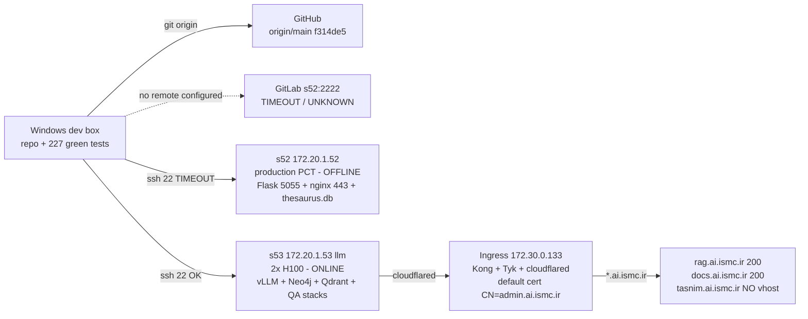

# PCM-20.6.0 — Phase 0 Baseline & Reconnaissance (READ-ONLY)

- **Mission:** Master two-track recon for **Track A (PCM-20.6.3)** Corpus Backfill Readiness (design-only pipeline for the 45,243 missing pages) and **Track B (PCM-20.6.4)** Tasnim Web V1 (API-first, Dockerized digital library at `tasnim.ai.ismc.ir`; no production deploy, no DNS/proxy changes in Phase 0).
- **Date:** 2026-11-06 (Asia/Tehran), recon window 11:20–19:35.
- **Method:** strictly read-only. Evidence sources: (a) direct reads of repo files, `.git/` internals (plain-text refs/reflog/config), factory-recorded manifests/registries, test outputs; (b) cached probe outputs from the PCM-20.6 baseline session (`docs/PCM-20.6-BASELINE.md`, `.tmp_pcm206_baseline_*` files — probe scripts + their captured outputs). No terminal in architect mode, so live re-hash / live git / live DNS were **not** re-run this session; every such value is cited to its recorded evidence with timestamp. No repo modification except this file. No git mutating command. No production touch.
- **Companion docs:** [`docs/PCM-20.6-BASELINE.md`](docs/PCM-20.6-BASELINE.md) (baseline run + probes), [`docs/PCM-20.6-CORPUS-V0003.md`](docs/PCM-20.6-CORPUS-V0003.md) (v0003 build report).

---

## 1. Git status per environment (deliverable 1)

### 1.1 Environment table

| Environment | Ref / location | SHA (full or as recorded) | Status |
|---|---|---|---|
| **Local — branch `pcm-20.6`** (current, `.git/HEAD`) | `refs/heads/pcm-20.6` | `20911d77108e8322ae8451ff292a53e38ce49d21` | **HEAD**, subject `pcm-20.6.2` (`.git/COMMIT_EDITMSG`) |
| **Local — branch `main`** | `refs/heads/main` | `11233e984fcb7ac5f1b7b68b5e6f81e3acfce54d` | `GATE 1 (PCM-20.5) — PASS`, 2026-11-05 18:52:26 +0330 |
| **GitHub** `origin` = `https://github.com/saber13812002/persian-corpus-toolkit.git` | `refs/remotes/origin/main` (loose ref) | `f314de544601fb0d7753e6199c9bd748cb25ef1a` | **2 commits behind local `main`**; `.git/packed-refs` (`834db8c9…`) and `.git/FETCH_HEAD` (`8db3b60a…`) are stale — treat loose ref as authoritative |
| **GitLab** | — | **UNKNOWN** | No GitLab remote configured in `.git/config` (single remote `origin`); s52:2222 (GitLab, not SSH) TIMEOUT at baseline → BLOCKED |
| **Server s52** (172.20.1.52, production) | — | **UNKNOWN** | Fully offline at probe time: ssh timeout; 6/6 ports 22/2222/443/80/4000/5055 TIMEOUT/CLOSED |
| **Server s53** (172.20.1.53, `llm`, GPU host) | — | N/A | No copy of the PCT repo on s53 (baseline §5.2) |

Evidence: `.git/HEAD`, `.git/refs/heads/*`, `.git/packed-refs`, `.git/FETCH_HEAD`, `.git/config`, `.git/logs/HEAD`, baseline §2–§4.

### 1.2 Verification of the 4 PCM-20.6 Subtask-02 commits

Reconstructed from `.git/logs/HEAD` reflog (chain: `11233e9` local main → `checkout pcm-20.6` → … → `20911d7`):

| Commit | Content | In local `pcm-20.6` | In local `main` | On GitHub `origin/main` | GitLab / s52 |
|---|---|---|---|---|---|
| `390ab25` | D1 — cs-20.6 semantic v0003: heading + hidden-context records | ✅ | ❌ | ❌ | unknown/offline |
| `52cd94b` | D2 — gap report + backfill design `bf-1` | ✅ | ❌ | ❌ | unknown/offline |
| `35e3fc9` | D3 — truncation formalization (source 2000-char cap) | ✅ | ❌ | ❌ | unknown/offline |
| `6c17b5e` | D4 — `deploy/pcm206_hc_pilot.py` LLM hidden-summary pilot (out of scope for Phase 0) | ✅ | ❌ | ❌ | unknown/offline |

Plus `05c9fd8` (گزارش) and `20911d7` (`pcm-20.6.2`) — also local-only. **All 4 target commits are PRESENT in the local branch `pcm-20.6` and nowhere else verifiable.**

### 1.3 The 3 previously-staged files — CONFIRMED PRESENT (must be preserved)

Per baseline §1.1 verbatim `git status --short` (2026-11-06 11:20), and each file verified present in the current root listing this session:

| Staged file | On disk now | Role |
|---|---|---|
| `A  .tmp_pcm205_readiness_s1.json` | ✅ present at repo root | PCM-20.5 S1 data-audit output (SHA/counts evidence) |
| `A  .tmp_pcm205_readiness_s1_probe.py` | ✅ present at repo root | probe script that produced the JSON |
| `A  "گزارش-PCM-20.5-READINESS.md"` | ✅ present at repo root (313 lines, dated 2026-11-05) | PCM-20.5 readiness report |

**These are staged-but-uncommitted PCM-20.5 deliverables. Any branch/worktree/commit work in later phases MUST preserve them** (they live at repo root, untracked-in-index-but-staged; a `git reset`/`checkout` mishap would orphan them). Also present: 10 untracked `.tmp_pcm206_baseline_*` probe files — cleanup is pending user decision (item 5 below).

---

## 2. Corpus v0003 verification table (deliverable 2)

Location: [`data/tasnim/pcm20_5/corpus/builds/v0003/`](data/tasnim/pcm20_5/corpus/builds/v0003/manifest.json). Contract `cs-20.6` (semantic v3) over canonical base `corpus:v0001` content, built 2026-11-06 12:35:21Z, registered in [`data/tasnim/pcm20_5/manifests/registry.json`](data/tasnim/pcm20_5/manifests/registry.json).

### 2.1 File-level table

| File | Size (B) | SHA-256 (factory-recorded, write-verified at build) | Count | Status |
|---|---|---|---|---|
| `pages.jsonl` | 170,629,785 | `8bec1bb8…` | 45,844 | **VERIFIED** (line count; sha per manifest) |
| `heading-records.jsonl` | 9,857,675 | `0a1e52a5…` | 10,739 | **VERIFIED** |
| `hidden-context-records.jsonl` | 17,895,082 | `f5e07013…` | 10,728 | **VERIFIED** |
| `context-records.jsonl` | 26,287,577 | `a1ac04216c38243a26ca40e1857ec210965cfdecb464bc70f06afcb54805a949` | 10,728 | **VERIFIED** + **byte-identical to cs-20.5 base** (gate S08; sha equals v0002's `context-records.jsonl` sha per `.tmp_pcm206_baseline_dataverify_out.json`) |
| `corpus.json` | 19,846 | `8e71a395…` | — | **VERIFIED** (structure S01) |
| `manifest.json` | — | manifest sha `0e50f52b…`; **`content_sha256 = 40f45e0b2c393a65569846aeaac4d45dcee4bd58a7f158b1554adf3755ca78e4`** | — | **VERIFIED**; `prev` → v0002 |

Registry chain (append-only): `corpus:v0001` content `ee87686a…` (REAL, 45,844) → `corpus:v0002` content `12a93e218bbc7a38d450749eca5ce25d0833b537cc13446048d430eade54f4a5` / manifest `dfbbad3d…` (semantic cs-20.5) → `corpus:v0003` content `40f45e0b…` / manifest `0e50f52b…`; source snapshot registered as `sfd927b663733`.

### 2.2 Headline counts

| Metric | Value | Status / evidence |
|---|---|---|
| Stored pages | **45,844** | **VERIFIED** — `pages.jsonl` line count + manifest `stats` + dataverify `gap_recompute.total_lines` |
| Heading records (cs-20.6) | **10,739** | **VERIFIED** — file line count + manifest `hidden_context.heading_records.count` |
| Hidden-context records | **10,728** | **VERIFIED** — file line count + manifest `hidden_context.context_records.count` |
| Missing `item_index` (backfill target) | **45,243** | **VERIFIED** — dataverify `gap_recompute`: `coverage_gap 45243 == declared 45243, match True` |
| Missing runs | **6** | **VERIFIED exact** — see §2.3 |
| Pages truncated at source cap (2000 chars) | **28** | **VERIFIED** — [`data/tasnim/pcm20_5/reports/truncation/truncation-report.json`](data/tasnim/pcm20_5/reports/truncation/truncation-report.json) `affected_pages`; GATE 1.5 PASS |
| Duplicate `item_index` rows | **18** (9 duplicate values) | **VERIFIED** — manifest `stats.duplicates`; all vol1×vol47 collisions |
| Empty pages | **35** | **VERIFIED** — `quality_flag_counts.empty` |
| Short pages (<20 chars, non-empty) | **12,366** | **VERIFIED** — `quality_flag_counts.short` |

### 2.3 Missing runs (exact, declared == recomputed, sum 45,243)

| Run (item_index inclusive) | Count |
|---|---|
| 3649–11182 | 7,534 |
| 11205–39003 | 27,799 |
| 44957–49956 | 5,000 |
| 55699–55701 | 3 |
| 55715–59590 | 3,876 |
| 89280–90310 | 1,031 |

### 2.4 Census (v0003)

- **Classification:** CONTENT_PAGE 33,443 · SECTION_HEADING 10,739 · SHORT_CONTENT 1,589 · EMPTY_PAGE 35 · UNKNOWN_STRUCTURE 38 · CHAPTER_HEADING 0.
- **Quality flags:** ok 33,399 · short 12,366 · empty 35 · truncated_at_2000 28 · dup_item_index 18 · no_barg 35 · missing_item_index 0.
- **delta-11** (10,739 − 10,728 = 11): 3 end-of-volume headings (no next page) + 8 headings whose next page is EMPTY_PAGE.
- **Volumes:** 6 blocks — `volume_no` 1, 12, 47, 56, 80 + `volkeyd531f422` (volume_no null); strategies url_section / text / none.

### 2.5 Verification caveats (honesty note)

1. The 33/33 baseline SHA check (11:20–12:05) **predates** the v0003 build (12:35:21Z). v0003 file SHAs are **factory-recorded** (write-verified: re-hash after write, raise on mismatch in `write_semantic`) and are corroborated by `.tmp_pcm206_v3_realcheck.py` evidence: v0002 base sha asserted unchanged (`12a93e21…` guard), H0 `heading_hash` and G0 `context_hash` recomputed OK from canonical JSON, `validate_corpus(v0003)` + `validate_semantic(v0003)` + `validate_corpus(v0002)` all pass.
2. No live re-hash of the ~225 MB v0003 set was possible this session (architect mode = no terminal). Status "VERIFIED" for SHAs therefore means *factory-recorded + independent recheck script + gate S08 byte-identity*, not a fresh re-hash.

---

## 3. Data-structure mapping (deliverable 3)

### 3.1 Identifier model

| Identifier | Definition | Uniqueness |
|---|---|---|
| `page_id` | `<volume_id>__p<item_index>` (+ `__d<n>` for dup rows) | **THE unique key** (enforced by gate V03, formula-checked in `validate.py`) |
| `item_index` | Crawl position from the source export; globally sparse 0..91077; 45,835 distinct of 45,844 rows | **NOT globally unique** — 9 duplicate values (vol1×vol47) |
| `barg` | Printed leaf number; `raw_barg` is Persian (e.g. `"۳۹٬۰۰۵"` → 39005 via `parse_barg_all_runs`, `common.py`) | Repeats per volume — not a key |
| `volume_id` | `volkey<hash>` of the source section | Stable per source section |
| `volume_no` | 1 / 12 / 47 / 56 / 80 / null | Coarse |

### 3.2 Page record (pages.jsonl)

`page_id, item_index, barg, raw_barg, position, source_page_id, text, content_hash, captured_at, metadata{barg_raw, url, content_hash, captured_at, item_index, export_barg, section, values_keys}, quality_status{status, flags[]}, semantic{ record_class, class_basis, class_rule, order{volume_no, volume_id, item_index, dup_rank, source_position, seq_in_volume, seq_global}, next_page_id, next_item_index, truncation{truncated_at_source, source_char_cap 2000, gate}, hidden_context{heading_record_id, context_record_id} }`

### 3.3 Heading ↔ hidden-context linkage (cs-20.6)

- **HeadingRecord** (`heading-records.jsonl`, `record_id = hctx:<page_id>`, 10,739): heading page + `parent` (nearest previous heading in the same volume) + `children` (same-volume pages up to the next heading) + provenance.
- **ContextRecord** (`hidden-context-records.jsonl`, `record_id = hcctx:<page_id>`, 10,728): `heading_page_id = context_page_id`; `next_page_id / next_item_index / next_source_page_id / next_volume_no`; `hidden_summary` = **verbatim ≤3 lines of the next page** (`summary_method = verbatim-extract/1.0`, `model = null` in the deterministic build); `summary_sha256`; provenance of the next page; `context_hash` = sha256 of canonical JSON of all fields except the hash.
- **Visibility policy:** `visibility = "hidden_context"` — **system-only (embedding/retrieval); never rendered publicly** (policy text in `corpus.json → semantic.hidden_context`).
- Page-side back-links: every heading page carries `semantic.hidden_context.heading_record_id` / `context_record_id`; `next_page_id` chains within a volume only.
- **Order key** (fixed): `["volume_no", "volume_id", "item_index", "dup_rank", "source_position"]`.

### 3.4 Factory pipeline & gates (for both tracks)

- Modules: [`schema.py`](corpus/tasnim/schema.py) (work/edition/volume/page, `page_id_of`, `assign_volume`), [`reconcile.py`](corpus/tasnim/reconcile.py) (quality flags in fixed order: empty → short<20 → truncated==2000 → no_barg → missing_index → dup_index), [`validate.py`](corpus/tasnim/validate.py) (**V01–V09**), [`semantic.py`](corpus/tasnim/semantic.py) (cs-20.5 / cs-20.6, **S01–S10**), [`gap_report.py`](corpus/tasnim/gap_report.py) (read-only gap census + `bf-1` backfill design + ≤10 live probes), [`truncation_report.py`](corpus/tasnim/truncation_report.py), CLI [`cli.py`](corpus/tasnim/cli.py) — subcommands `audit`, `build-corpus`, `validate-corpus`, `build-semantic (--contract cs-20.5|cs-20.6)`, `build-dataset`, `export-dump`, `diff`, `semantic-diff`; exit codes 0 OK/REUSED, 1 validation fail, 2 input error.
- Key gates: V03 page_id uniqueness+formula · V05 `parse_barg_all_runs(raw_barg) == barg` · V06 normalized-text policy · V09 `truncated_at_2000 flag ⟺ len(text)==2000` · S08 v0003 `context-records.jsonl` byte-identical to cs-20.5 base + count/policy/evidence-sha checks · S09 full deterministic re-derivation of both record files · S10 truncation recompute (flag ⟺ len==2000, affected-list equality).
- Determinism: canonical JSON (sort_keys, indent=1); `content_sha256` over the file set; manifest `prev` chain + append-only `registry.json`; idempotent builds (REUSED when content sha matches); write-verify (re-hash after write, raise on mismatch).
- **Source 2000-char cap proven to be the source site's own cap** (PCM-20.5 GATE 1.5 PASS, evidence sha `b0f45e9381db78da8a16b8e577038e2de8a8897f0c59c38b01cf1dc192d5158d`): E1 no truncation code in pipeline · E2 no pile-up (28 at exactly 2000 vs 288 at 1990–1999; p50=64 p90=1710 p95=1885 p99=1985 max=2000) · E3 tail distribution matches control · E4 live `GET https://tasnim.hamtaa.org/api/v1/files/tasnim/chunk-detail?item_index=N` returns exactly 2000 for items 39137 & 66532.
- Backfill design **bf-1** (`gap_report.backfill_design`, **design-only, never executed**): 6 steps (≤10 reachability probes → rate-limited crawl ~4 pages/min → append to new snapshot `source-snapshot-backfill/*.jsonl` with per-record provenance → register as new append-only snapshot version → merged rebuild where **on content-hash conflict the OLD record wins** and the conflict is logged → re-validate V01–V09 + S01–S10); safety: no deletion without evidence, no overwrite; estimate **45,243 pages @ 4/min ≈ 188.5 h ≈ 7.9 days**.

### 3.5 File layout & sizes (data root)

| Path | Size (B) | SHA-256 |
|---|---|---|
| `data/tasnim/pcm20_4/source-snapshot/tasnim-corpus.jsonl` (registered `sfd927b663733`) | 72,906,133 | `fd927b66…` |
| `…/tasnim-corpus.json` | 72,959,214 | `cee2c08a…` |
| `…/export-summary.json` | 408,016 | `1b96b1b0…` |
| `…/pcm20_2_audit.json` | 63,188 | `db6c30f4…` |
| `pcm20_5/corpus/builds/v0003/` (5 files, §2.1) | ≈ 225 MB total | content `40f45e0b…` |
| `pcm20_5/datasets/` — 1% 458 `a407021e…` · 10% 4,584 `7de515a6…` · 10%/v0002 vol56 2,969 `11ab83ce…` · 50% 22,922 `7c15be3f…` · 90% 41,260 `8ef9aab8…` · 100% 45,844 `37673c3d…` | — | — |
| Dumps — 10%/v0001 (2,197 rec / 772 skip) · 10%/v0002 (3,416 / 1,168) · 100%/v0001 (33,443 / 12,401); all external builds `--mock-embed` 1024-dim, `DUMP_VALIDATED 0 errors` | — | — |
| Registries — `pcm20_4` `83abe05c…` · `pcm20_5` `e8474e4b…` · crossroot `df056d01…` | — | 33/33 ALL_MATCH at 11:20–12:05 |

---

## 4. Volume-mapping ambiguity verdict (deliverable 4)

**Verdict: AMBIGUOUS-WITH-EVIDENCE.** Volume assignment by bare `item_index` (or by `barg`) is **not** a well-defined function on this corpus.

Evidence:
1. **9 duplicate `item_index` values** (18 rows) — all vol1×vol47 collisions; `reconcile.find_duplicate_indexes` records `value_count`/`extra_rows` per value.
2. **Volume `item_index` spans overlap** across volumes (volumes are split by source URL section, not by contiguous index ranges — `volume_strategy_census`: url_section / text / none).
3. The factory code itself treats the mapping as best-effort: `gap_report.volume_map_from_pages` builds `item_index → (volume_no, title)` with `setdefault`, so on a duplicate the **first volume encountered wins** — a silent choice, not a validated one.
4. `barg` repeats per volume (printed leaf numbers), so it cannot disambiguate either.

**Consequences:**
- Track B (web API): every public endpoint, URL slug, and search key must use **`page_id`** (`<volume_id>__p<item_index>[__d<n>]`). Bare `item_index` may be exposed as a *display/provenance field* only, never as a unique identifier.
- Track A (backfill): recovered records must be reconciled to volumes via `source_page_id`/URL section first; the merged snapshot must keep both `item_index` and the resolving volume context so duplicates stay resolvable.
- Validation hook: any new dataset/dump that joins on bare `item_index` should fail a gate (candidate new check: uniqueness of the join key).

---

## 5. Org architecture patterns + ports in use (deliverable 5)

### 5.1 Topology (pattern summary)



Patterns relevant to Track B:
- **Per-service Docker Compose** on the GPU host; **shared ingress** (Kong `kong-gw-oss` + Tyk `:8290` + cloudflared tunnels) — **no nginx on s53**.
- **One Neo4j database per RAG collection** (graph-rag uses default `neo4j`; rag-portal uses `taghrir` via `bolt://172.20.1.53:7687`).
- **Auth pattern** (Track B reference): [`backend/auth.py`](backend/auth.py) PCM-09 — single dashboard password, scrypt `scrypt$it$salt$digest` (n=16384, r=8, p=1, dklen=32) in `auth_meta`, seeded from `PCT_DASHBOARD_PASSWORD` (plaintext never persisted); 32-byte `secrets.token_urlsafe` sessions, 7-day expiry, cookie `pct_session` HttpOnly+Secure+SameSite=Lax; DB-backed rate limit 5 fails/10 min per IP; routes `POST /api/auth/login|logout`, `GET /api/auth/status`; **read-only namespaces behind auth, extension write APIs stay open** (AGENTS.md hard rule 6).
- **Existing web pattern:** `dashboard/index.html` — frameworkless single-page HTML+JS, RTL, all fetches `credentials: same-origin`, 401 → login overlay.
- `.gitlab-ci.yml` exists — CI is **test-only** (200-test regression + OpenAPI check + sample client); **no deploy job** (AGENTS.md rule).
- RAG state (baseline §8): **no Tasnim RAG collection exists**; zero real embeddings anywhere in `data/` (all mock 1024-dim); every dump predates semantic v0002; `LITELLM_BASE=http://172.30.0.133:4000/v1` untested from our network.

### 5.2 Port-in-use inventory (s53, live-probed 2026-11-06)

| Port | Service | Notes |
|---|---|---|
| 4000 | vllm-embedding | **Qwen3-Embedding-4B, dim 2560** (live-measured), max_model_len 32768 |
| 4001 | vllm-embedding-06b | **Qwen3-Embedding-0.6B, dim 1024** (live-measured), 8192 |
| 11434 | ollama | mxbai-embed-large, dim UNKNOWN (BLOCKED) |
| 8000 / 8001 | vLLM LLM | Qwen3.8-27B-FP8 chat, max_model_len 200,000 (admin 8001) |
| 7474 / 7687 | Neo4j 2025.10.1-enterprise | Up 5 days healthy; 401 unauthenticated on 7474 |
| 6333 | Qdrant v1.19.1 | healthz OK; `/collections` needs API key |
| 9001 | mock-litellm | env keys only |
| 8033 / 8034 | ragportal | rag.ai.ismc.ir |
| 8003/8004, 8013/8014, 8023/8024, 8043/8044, 8053/8054 | QA stacks | mesbah / eiis / taghrir / sources / radio / ragportal |
| 5436, 5446, 5456, 5466, 5477 | feedback Postgres | per-stack |
| 8290 | Tyk API | Kong admin via `docker exec … :8001` |
| — | h200-public-tunnel | cloudflared |

s52 (when online): 5055 PCT backend (bound 127.0.0.1), 443 nginx ssl → 5055 with X-Forwarded-Proto, 22 ssh, 2222 GitLab. Host hardware s53: 40× Xeon Gold 6458Q, 117 GiB RAM, 1.5 TB disk (295 G free), 2× NVIDIA H100 80GB HBM3 — GPU0 74,991/81,559 MiB (~92%), GPU1 66,878 (~82%), both 100% util (resident vLLM).

---

## 6. Domain status — `tasnim.ai.ismc.ir` (deliverable 6)

| Check | Result | Evidence |
|---|---|---|
| DNS | `tasnim.ai.ismc.ir` → **172.30.0.133** (same ingress as all `*.ai.ismc.ir`; resolver 172.22.6.1, non-authoritative) | baseline §9, `.tmp_pcm206_baseline_domains.ps1` output |
| TLS | **default cert `CN=admin.ai.ismc.ir`** (Let's Encrypt YE2, expiry 2027-01-01, thumbprint `76D433EF…`) → `SEC_E_WRONG_PRINCIPAL`; HTTP probe 000 from Windows client | same |
| Dedicated vhost? | **NONE** — SNI falls to the default vhost | inferred from default-cert behavior; no vhost config visible |
| Controls | `rag.ai.ismc.ir` — CN correct, 200 (portal live, `/api/health` 200) · `docs.ai.ismc.ir` — CN correct, 200 (Wiki.js; REST API v2 disabled/404) | baseline §9 |

**Verdict:** domain is **DNS-ready but unprovisioned** — setup work = dedicated vhost + Let's Encrypt cert at the ingress (pattern already proven by [`deploy/nginx-corpus.vhost.conf`](deploy/nginx-corpus.vhost.conf): 80→301→443, ACME `/www/acme`, proxy to 127.0.0.1 upstream) + the backend app. **GO with setup work** (baseline §12). No DNS/proxy changes are permitted in Phase 0; the ingress owner is a dependency, not an action item for this phase.

---

## 7. Worktree / branch recommendation (deliverable 7)

- **Base commit:** `20911d77108e8322ae8451ff292a53e38ce49d21` — HEAD of local `pcm-20.6` (contains all four Subtask-02 commits + report + `pcm-20.6.2`).
- **New branch:** `pcm-20.6-tasnim-web-v1` (Track B). Track A design work can continue directly on `pcm-20.6`.
- **Recommended layout (git worktree, keeps the 3 staged files untouched):**
  ```text
  git worktree add ../pcm-20.6-tasnim-web-v1 -b pcm-20.6-tasnim-web-v1 20911d77108e8322ae8451ff292a53e38ce49d21
  ```
  - Current worktree stays on `pcm-20.6` → the 3 staged PCM-20.5 files remain exactly as-is (staged, uncommitted).
  - The new worktree is a clean checkout of the base commit — no staged files, no probe litter.
  - Sibling-directory path (`../pcm-20.6-tasnim-web-v1`) avoids nesting a worktree inside the repo.
- **Precondition (user decision, not a Phase-0 blocker):** the user's pending will on committing/pushing local `main` (1 commit ahead of GitHub) and the 3 staged files. Until then, **no push** from either track (AGENTS.md: test → commit → push → deploy → smoke test, stepwise).
- CI note: `.gitlab-ci.yml` runs tests only — the new branch's first mergeable state must keep the 200-test regression green (backend) + 27 corpus tests.

---

## 8. Risk register (deliverable 8)

| # | Risk | Track | Severity | Mitigation / status |
|---|---|---|---|---|
| R1 | **s52 fully offline** — production PCT, `thesaurus.db`, and the original live re-crawl path unreachable | A, B | High | Track A stays **design-only**; any execution waits for s52. Track B can build on local + s53 staging. Re-probe before any deploy phase. |
| R2 | **GitLab unreachable** (s52:2222 TIMEOUT) and no GitLab remote in `.git/config` | both | Medium | GitLab mirror state UNKNOWN; do not assume it exists. Push strategy = GitHub `origin` only until proven otherwise. |
| R3 | **Unpushed/uncommitted local state** — `pcm-20.6` is 6 commits local-only; `main` 1 commit ahead of GitHub; 3 staged files uncommitted | both | Medium | Worktree strategy (§7) preserves staged files; commit cadence per AGENTS.md rule 4; no force-push, no `reset --hard`/`clean -fd`. |
| R4 | **`item_index` ambiguity** (9 dups, overlapping spans, `setdefault` mapping) | A, B | High for B | Key everything on `page_id` (§4); new join-key uniqueness gate candidate. |
| R5 | **45,243 missing pages** — recovery needs live crawl ~4 pages/min ≈ 188.5 h; site `/payload` now returns an SPA shell (GATE 0-D); only the `chunk-detail` API endpoint is a proven read path | A | High (execution blocked) | `bf-1` design with ≤10-probe safety cap, append-only provenance, old-wins on hash conflict; live re-check before any crawl (GATE). |
| R6 | **Source 2000-char cap is irreversible** (GATE 1.5 PASS) — 28 pages are truncated at the source | A, B | Medium | Flag, never "fix": V09/S10 enforce `flag ⟺ len==2000`; UI must surface truncation state honestly (AGENTS.md rule 9: no invented stats). |
| R7 | **GPU contention on s53** — H100×2 at ~92/82% with resident vLLM; all current data uses mock embeddings | B (later RAG) | Medium | Embedding workload must be scheduled/queued; dim choice (1024 vs 2560) is a pending user decision — it freezes Qdrant/Neo4j collection specs. |
| R8 | **Neo4j credentials unknown** (401 on 7474; DB list BLOCKED) | B | Medium | Follow the org pattern: new dedicated `tasnim` database, never shared `neo4j`/`taghrir`; obtain credentials from infra owner in the deploy phase. |
| R9 | **Qdrant API key required** — collection listing BLOCKED; dim mismatch risk 1024 vs 2560 | B | Medium | Same root as R7; decide model first, then provision collection with matching dim. |
| R10 | **Shared ingress (Kong/Tyk)** at 172.30.0.133 with default cert — vhost+cert provisioning for `tasnim.ai.ismc.ir` needs the ingress owner; Phase 0 explicitly makes no proxy/DNS changes | B | Medium | Design the vhost conf now (pattern: `deploy/nginx-corpus.vhost.conf`); execution is a later-phase, owner-coordinated step. |
| R11 | **hidden_context policy breach** — 10,728 hc records are system-only; accidental public rendering would violate the recorded policy | B | Medium | Contract: hc fields excluded from any public serializer; test asserting absence in API responses. |
| R12 | **Deployment topology open** — no nginx on s53; web app could be a new s53 compose service behind Kong, or a dedicated host | B | Low | Decide in Phase 1 design; both are compatible with the evidence above. |
| R13 | **Data volume & API hygiene** — v0003 ≈ 225 MB; 100% dataset 45,844 records; AGENTS.md rule 7 bans full-table loads | B | Medium | API-first with `LIMIT/OFFSET` pagination, parameterized SQL, whitelist `ORDER BY`; static serving of JSONL for bulk only. |
| R14 | **Windows dev environment** — open DB handles block `os.remove`; keep `teardown_appcontext` pattern; `pct_test_support.reset_db()` mandatory for new tests | both | Low | Follow existing test harness (PCM-12.3 F-01 fix). |
| R15 | **Provenance-chain integrity** — registry is append-only; backfill merge must keep old-record-wins on content-hash conflict | A | High (if violated, silent) | bf-1 design encodes it; any implementation needs a test that a conflicting re-crawl does NOT overwrite. |

Blocked sub-items carried from baseline B1–B10 (all s52/credential-gated, none blocking Phase 1 design): s52 reachability, s113/s117, GitLab, qdrant listing, neo4j DB list, Kong/Tyk route detail, ollama dim, `LITELLM_BASE` from our network, Wiki.js REST v2, 45,243 recovery.

---

## 9. Frontend design skills inventory — Phase 2 readiness (deliverable 9)

| Skill | What it provides | Use in PCM-20.6.4 |
|---|---|---|
| `ui-ux-pro-max` | Searchable design intelligence: 79 styles, 192 product palettes + reasoning profiles, 74 font pairings, 119 UX guidelines, 105 icons, 17 GSAP presets, 25 chart types, 22 stacks | **Primary** — RTL Persian typography, palette, component-pattern research for the digital library |
| `design-system` | 3-layer tokens (primitive→semantic→component), CSS variables, spacing/typography scales, component specs | Define the Tasnim Web design tokens consistent with the existing dashboard |
| `ui-styling` | shadcn/ui (Radix+Tailwind) components, utility-first styling, accessibility (dialogs, dropdowns, forms, tables), theming/dark mode | Implementation reference if a framework is adopted; otherwise borrow the a11y/theming guidance for the frameworkless build |
| `design` | Brand identity, logo (55 styles), CIP, HTML presentations, banners, icons, social photos | Identity/branding assets, roadmap decks |
| `brand` | Voice, messaging frameworks, brand consistency | Optional, only if a brand charter is requested |
| `slides` | Strategic HTML presentations with Chart.js + design tokens | Status/roadmap presentations (optional) |
| `banner-design` | Banners for social/ads/website hero | Launch/hero assets (optional) |

**Recommended Phase-2 sequence:** `ui-ux-pro-max` (research) → `design-system` (tokens) → `ui-styling` (implementation guidance). Constraint from the existing codebase: `dashboard/index.html` is frameworkless RTL HTML+JS with `credentials: same-origin` fetch + 401 overlay — the mission's "API-first" web v1 should either follow that pattern or consciously adopt a framework, decided in Phase 1.

---

## 10. Go / No-Go & pending user decisions

**Go/No-Go (Phase 1 entry):**
- Local corpus/data chain: **GO** (all §2 counts VERIFIED; 227 tests green at baseline; 33/33 SHAs matched pre-v0003).
- Track A (backfill **design**): **GO** — bf-1 design + gap report already committed on `pcm-20.6`; execution remains BLOCKED on s52 + live-site cooperation (R1/R5).
- Track B (web v1 build, no deploy): **GO with setup work** — DNS active; vhost + cert + backend app are the remaining provisioning steps (§6, R10).
- RAG/embedding: **GO conditional** on the embedding-model decision (R7/R9).

**Pending user decisions (from baseline §12, unchanged by this recon):**
1. Commit/push local `main` (1 commit) + the 3 staged PCM-20.5 files — user will.
2. Embedding model: Qwen3-Embedding-0.6B (1024) vs 4B (2560) — freezes RAG collection specs.
3. 45,243 recovery strategy: direct re-crawl of the live API vs waiting for s52.
4. Whether the 10,728 hidden-context records enter embedding/chunking (policy permits system-only use; scope of use is a product decision).
5. Cleanup of the 10 untracked `.tmp_pcm206_baseline_*` probe files.

---

*Prepared read-only; no repo modification other than this document; no git mutation; no production touch. All SHAs/counts cited to factory records, `.git/` internals, or timestamped probe outputs listed above.*
